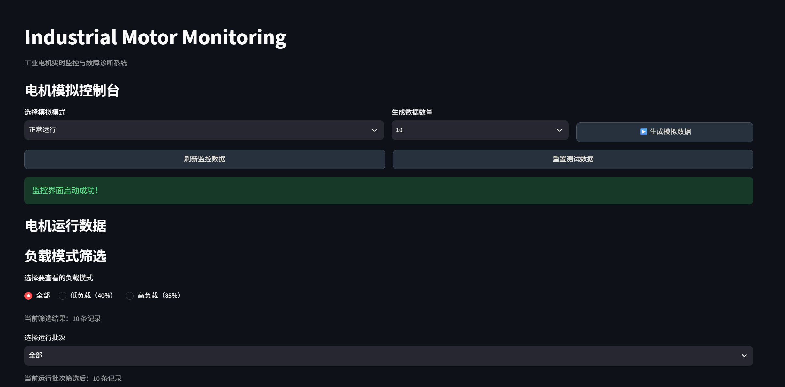
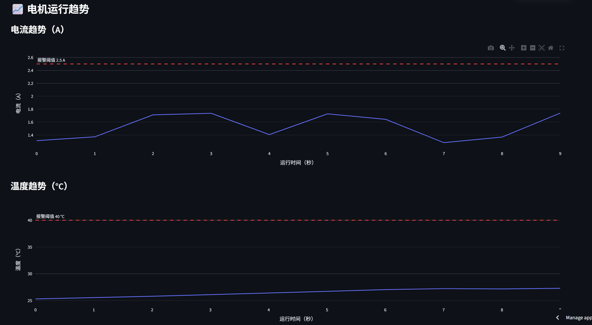

# Industrial Motor Monitoring & Fault Diagnosis System
[](https://industrial-motor-monitor.streamlit.app/)

🌐 **Live Demo:** https://industrial-motor-monitor.streamlit.app/
基于 Python 和 Streamlit 开发的工业电机模拟监控与故障诊断系统。

## 项目简介

本项目通过模拟工业电机运行数据，构建一个可视化监控仪表板，实现电机运行状态监测、异常报警、故障诊断和批次风险分析。

项目主要用于 Python 编程学习及工业设备监控系统的模拟实践。
## Dashboard Preview

### Main Interface


### Trend Analysis

The dashboard visualizes motor current, temperature, and speed trends to help monitor operating conditions and identify abnormal behavior.


## 主要功能

- **电机数据模拟**：支持正常运行、过载、过热和低转速四种模拟模式。
- **实时监控仪表板**：展示电流、温度、转速及运行状态。
- **报警检测**：根据设定阈值识别异常运行情况。
- **故障诊断建议**：根据报警类型提供相应的检查建议。
- **趋势分析**：使用 Plotly 展示电流、温度和转速变化趋势。
- **批次管理**：通过 Run ID 区分不同运行批次。
- **风险分析**：统计各批次报警数量、报警占比和风险等级。
- **CSV 数据导出**：支持导出原始监测数据、报警记录和批次风险分析报告。

## 技术栈

| 技术 | 用途 |
|---|---|
| Python | 核心编程语言 |
| Streamlit | Web 可视化仪表板 |
| Pandas | 数据处理与分析 |
| Plotly | 数据可视化 |
| CSV | 数据存储与导出 |

## 项目结构

```text
industrial-monitor/
├── dashboard.py
├── motor_simulator.py
├── alarm_utils.py
├── alarm_test.py
├── analyze_motor.py
├── requirements.txt
├── .gitignore
└── README.md
```

运行过程中还会生成 `motor_data.csv` 和 `run_id.json` 等本地数据文件。

## 安装与运行

### 1. 克隆项目

```bash
git clone https://github.com/你的GitHub用户名/industrial-motor-monitor.git
```

### 2. 进入项目目录

```bash
cd industrial-motor-monitor
```

### 3. 安装依赖

```bash
pip install -r requirements.txt
```

### 4. 启动监控系统

```bash
python -m streamlit run dashboard.py
```

启动后，根据终端显示的本地地址，在浏览器中打开监控仪表板。

## 模拟运行模式

| 模式 | 模拟情况 |
|---|---|
| Normal | 正常运行 |
| Overload | 电流过高 |
| Overheat | 温度逐渐升高 |
| Low Speed | 转速过低 |

## 项目说明

本项目为教学用途的工业电机模拟系统。报警阈值和模拟数据均为演示设定，不代表真实工业设备的安全标准。

## 后续改进方向

- 增加实时数据流模拟
- 增加历史运行数据分析
- 优化故障诊断逻辑
- 探索机器学习故障预测模型

## Author

Created as a Python and Streamlit industrial monitoring project.
